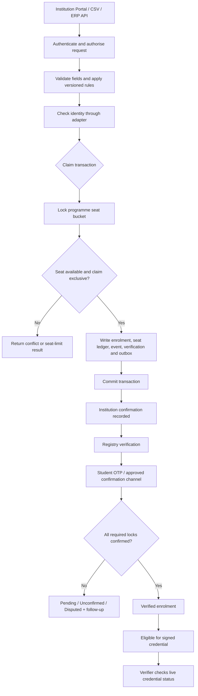
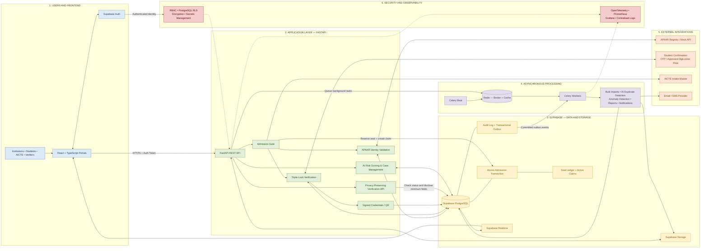

# Siksha Setu

> **A trust and admission-integrity layer for AICTE** — designed to help prevent excess admissions, duplicate enrolments, and unverifiable student records at the point of admission.

**Event:** Smart India Hackathon 2026 · Smart Automation · Software  
**Important:** This README describes the system design. Features described as *planned*, *proposed*, or *production target* should not be interpreted as already implemented or connected to live government systems.

---

## Table of Contents

- [1. Overview](#1-overview)
- [2. The Problem](#2-the-problem)
- [3. What the System Does](#3-what-the-system-does)
- [4. User Portals](#4-user-portals)
- [5. Admission Workflow](#5-admission-workflow)
- [6. Business Rules and Important Cases](#6-business-rules-and-important-cases)
- [7. Architecture](#7-architecture)
- [8. Technology Stack](#8-technology-stack)
- [9. Data and Database Design](#9-data-and-database-design)
- [10. Security, Privacy and Integrity](#10-security-privacy-and-integrity)
- [11. Intelligence and Explainability](#11-intelligence-and-explainability)
- [12. Integrations](#12-integrations)
- [13. Production Roadmap](#13-production-roadmap)
- [14. Testing Strategy](#14-testing-strategy)
- [15. Design Principles](#15-design-principles)

---

## 1. Overview

**Siksha Setu** is designed as a trust layer in front of the AICTE enrolment process. Instead of checking only aggregate enrolment totals after admissions have taken place, the system checks a claim when an institution attempts to admit a student.

Its core idea is:

1. Validate and resolve the student's identity without making APAAR availability a condition for being counted.
2. Check the programme's approved intake against a live, typed seat ledger.
3. Prevent conflicting exclusive enrolment claims across institutions.
4. Track independent institution, registry and student confirmations.
5. Preserve an auditable history of changes and decisions.
6. Provide role-specific dashboards and privacy-preserving verification.

The system is designed around a **claim-then-admit gate**. The database—not only frontend validation—must enforce seat capacity and exclusive claims so concurrent requests cannot bypass the rules.

### At a glance

| Item | Description |
|---|---|
| Project | Siksha Setu |
| Domain | Education technology, admission integrity, student-record verification |
| Primary stakeholder | AICTE |
| Architecture | Modular monolith with separately scalable process types |
| Transactional source of truth | PostgreSQL (planned deployment through Supabase) |
| Backend design | Python 3.12, FastAPI |
| Frontend design | React 18, TypeScript, Vite |
| Background processing | Celery and Redis |
| Development/demo data | Synthetic records and labelled mock integrations |
| Production ambition | National-scale, secure and auditable enrolment-integrity platform |

## 2. The Problem

Traditional enrolment reporting often identifies discrepancies after admission data has already been submitted. Aggregate totals alone cannot reliably establish whether each student is genuine, whether a student is claimed by multiple institutions, or whether a programme has exceeded its approved intake.

Siksha Setu is designed to address five related issues:

- **Over-admission:** a programme accepts more students than its approved seat capacity.
- **Duplicate enrolment:** the same student holds conflicting exclusive seats in the same admission cycle.
- **Ghost or borrowed-identity enrolment:** a record is submitted without sufficient independent confirmation from the student.
- **Identity-data problems:** an APAAR ID is invalid, unavailable, mismatched or not yet generated.
- **Low-trust verification:** an employer or other verifier has to rely on paper copies or receive more student information than is necessary.

The platform aims to move controls from retrospective audits to the admission transaction itself.

## 3. What the System Does

The full design groups its capabilities into the following areas.

### 3.1 Admission Gate and live seat ledger

- Checks approved intake for the relevant institution, programme, academic year and seat type.
- Tracks regular, lateral-entry and separately defined supernumerary seat buckets.
- Raises an alert when a bucket reaches 90% occupancy.
- Stops a claim at 100% capacity unless a valid, approved exception applies.
- Uses a database row lock and transaction to prevent concurrent over-allocation.
- Releases occupied capacity through an explicit withdrawal event.
- Records approved exceptions with justification, evidence and expiry.

### 3.2 APAAR identity validation and provisional identity

- Validates identifier format and checksum where the applicable specification is known.
- Checks registry status and compares names and date of birth when a registry response is available.
- Diagnoses mismatches field by field and suggests corrections.
- Supports provisional identity paths for students whose APAAR ID has not been generated, who decline consent for a particular registry interaction, or who are foreign students.
- Keeps the student in the workflow rather than silently treating a missing APAAR ID as proof of fraud.
- Flags potential multiple-APAAR-ID situations for registry-owner review instead of automatically merging identities.

### 3.3 Triple-Lock verification

An enrolment becomes fully verified only after three independent checks:

1. **Institution confirmation:** the institution submits and attests to the enrolment claim.
2. **Registry confirmation:** the identity is checked against the APAAR registry, where access is available.
3. **Student confirmation:** the student confirms through an approved channel, such as OTP; a future integration may use DigiLocker.

The design includes guardian confirmation for minors and assisted confirmation for students without access to a phone. Unconfirmed or disputed cases remain visibly labelled; they must not be silently presented as verified.

### 3.4 Validation rules and findings

- Applies a common rule set to portal submissions, bulk uploads and API/ERP submissions.
- Uses typed rules, versioned rule sets, evidence-backed findings and suggested fixes.
- Checks identity, duplicates, intake, category consistency, cross-field conditions and aggregate reconciliation.
- Supports acknowledgement, resolution and reviewer-authorised waiver workflows.
- Stores the rule-set version used for a decision.

### 3.5 Bulk data ingestion

The design supports institutional uploads and system-to-system submissions:

- Template-based CSV/Excel uploads.
- Browser-side pre-validation.
- Row-level error reporting and correction guidance.
- Dry-run validation before committing admissions.
- Diff views and partial acceptance where permitted.
- Resumable/chunked upload for large files.
- Malware, file-type and CSV-formula-injection checks.
- Idempotent re-uploads using stable row keys.
- REST APIs, webhooks and scheduled ERP synchronisation.

### 3.6 Duplicate detection and transfer handling

- Exact matching through keyed identity hashes at claim time.
- Asynchronous fuzzy matching for likely duplicates.
- Blocking keys and similarity scoring to narrow candidate comparisons.
- Timeline classification and a human-review queue.
- Transfer-in/transfer-out lifecycle and orphan-transfer leads.
- Explicit handling for legitimate concurrent programmes and approved exceptions.

### 3.7 Trust Index, anomaly alerts and case management

- Produces a proposed Trust Index from 0 to 100 to prioritise review.
- Combines identity/confirmation status, claim attempts, duplicate leads and available corroborating feeds.
- Uses anomaly detection and graph clustering to identify unusual patterns.
- Presents evidence and explanations for each alert.
- Supports case ownership, response windows, outcomes and appeals.

**The Trust Index is a review-prioritisation signal, not an automatic finding of fraud or a final verdict.** Human review remains essential.

### 3.8 Dashboards and reporting

- Institution dashboard for submissions, validation findings, seat utilisation and correction status.
- AICTE dashboard for aggregate enrolment, intake utilisation, unresolved verification, anomaly leads and cases.
- Freshness timestamps on dashboard data.
- PDF, Excel and CSV reports in the full design.
- Regulatory and accreditation reporting packs.
- Suppression of small groups (proposed threshold: groups below five) to reduce re-identification risk.
- Optional natural-language query support, restricted to approved structured queries and aggregate data.

### 3.9 Student wallet, consent and correction requests

The intended student portal allows students to:

- View their own enrolment and verification state.
- See access and verification history.
- Review and withdraw consent where consent is the applicable legal basis.
- Share a limited verification link.
- Request correction of an official record.
- Submit data-subject requests through the defined workflow.

Students can request corrections; they do not directly overwrite authoritative institutional fields.

### 3.10 Signed credentials and privacy-preserving verification

The production design proposes digitally signed verifiable credentials, a QR code and a live status check. A verifier should receive only the minimum signed answer needed for the stated purpose—for example, whether an enrolment credential is valid—not the student's full record.

- Credential signatures use ES256 in the proposed design.
- Credentials have status/revocation checks.
- Verification requests are purpose-bound and protected against replay using a nonce and short validity period.
- Unknown identifiers should receive neutral responses to reduce information leakage.
- Aadhaar is never stored or printed.

### 3.11 Audit and tamper evidence

- Append-only enrolment events, seat ledger entries and audit records.
- Hash-chained audit log and signed checkpoints.
- Merkle-root commitments for institutional cohort snapshots.
- Institution signature and proposed AICTE countersignature at cut-off.
- Separate, write-once/read-many (WORM) copies for sealed evidence in the production design.

The system deliberately uses tamper-evident cryptographic structures rather than requiring a blockchain.

### 3.12 Policy simulator

A planned policy simulator replays a proposed rule set against historical event snapshots in read-only mode. It estimates which institutions and programmes would be affected and the resulting reviewer workload before the rule is approved for use.

## 4. User Portals

The target design includes four role-specific portals. Exact screens and available actions depend on what is implemented in the current system.

| Portal | Main purpose |
|---|---|
| **Institution** | Submit individual claims or bulk files, review seat usage, resolve validation findings, manage institution users and track student confirmations. |
| **AICTE / Administrator** | Review institution data, monitor aggregate enrolment and intake, manage reference data and policy rules, investigate alerts, and access student-level details only through an authorised case workflow. |
| **Student** | View personal enrolment status, complete confirmation, see access history, share verification links and request corrections. |
| **Verifier** | Verify a credential or QR and receive a minimal signed result without browsing the full student record. |

### Access principle

Portals are different views over one governed system—not separate databases with independent business rules. All admission channels must pass through the same backend rules and admission gate.

## 5. Admission Workflow

### Why the database transaction matters

A frontend check alone cannot safely enforce capacity: two institutions could submit at nearly the same time and both see a seat as available. The design therefore performs the decisive seat and exclusivity checks inside PostgreSQL, with a row lock, constraints and a single atomic transaction.

The registry request is made before that transaction so a slow external system does not hold database locks.

## 6. Business Rules and Important Cases

The following rules describe the intended behaviour and should be treated as the design baseline. The current codebase should be checked before claiming each rule is already implemented.

### 6.1 Seat-capacity rules

| Situation | Intended outcome |
|---|---|
| Occupancy reaches 90% of the bucket cap | Accept a valid claim if all other checks pass and raise a warning/alert. |
| Bucket is at 100% and no approved exception exists | Reject the claim with a seat-limit result. |
| A legitimate overflow has a valid reviewer-approved exception | Apply the exception according to its scope, evidence and expiry. |
| A student withdraws | Record a withdrawal/release event and update occupied-seat accounting. |
| Seat type is lateral entry or supernumerary | Count against its own configured bucket, not an assumed hard-coded percentage. |
| Multiple claims arrive concurrently | Lock and update the relevant bucket atomically; do not oversell seats. |

### 6.2 Identity and duplicate cases

| Situation | Intended outcome |
|---|---|
| Valid identity, seat available, no conflicting exclusive claim | Create the claim and return its claim reference. |
| Same identity already claimed at the same institution | Return an idempotent result or a same-institution duplicate result; do not create a second seat. |
| Same student has an active exclusive claim at another institution in the same cycle | Return a conflict and provide a safe resolution reference; do not disclose the other student's private data. |
| Identity format/checksum is invalid | Return a field-level error and correction guidance. |
| Registry is unavailable | Keep the claim visibly pending verification and retry; do not silently mark it verified. |
| Name/DOB differs but a likely correction can be diagnosed | Send the record for correction or human review. |
| APAAR ID is not generated or is unavailable | Use a provisional identity path with the required deadline and review controls. |
| Foreign student has no APAAR ID | Use the configured provisional identity process; do not reject solely for lacking APAAR. |
| Potential duplicate identity records are found | Flag for review; do not automatically merge records. |

### 6.3 Concurrency classes

The design distinguishes four enrolment classes:

- `EXCLUSIVE` — ordinary full-time enrolment; participates in the one-exclusive-claim rule.
- `CONCURRENT_OK` — approved modes such as eligible online, ODL or part-time study; handled under the applicable policy.
- `EXCEPTION_APPROVED` — a reviewed exception explicitly allows the combination.
- `TRANSFER_PENDING` — a transfer-in is recorded before the matching transfer-out is confirmed; an unresolved case can become an orphan-transfer lead.

The exact programmes and exceptions allowed must come from approved, versioned policy data.

### 6.4 Validation severities

| Severity | Meaning |
|---|---|
| `Blocker` | Stops acceptance. |
| `Error` | Must be fixed or formally approved before submission. |
| `Warning` | Requires institution acknowledgement; an authorised AICTE reviewer may waive it with a reason. |
| `Info` | Informational; no action is required. |

Each finding should include the evidence, rule version and suggested fix. The design statuses are `OPEN`, `ACKNOWLEDGED`, `RESOLVED` and `WAIVED`.

### 6.5 Verification states

The system must distinguish states such as `VERIFIED`, `PROBABLE_MATCH`, `PENDING_FIX`, `PENDING_VERIFICATION`, `INVALID`, and `UNCONFIRMED`. Exact enum values should match the backend implementation and database migrations.

A missing or pending external response is not equivalent to a successful verification.

### 6.6 Submission lifecycle

The designed submission states are:

`Draft → Validated → Submitted → Accepted / Under Review → Corrected → Locked`

Transitions are governed by submission windows, validation results, correction workflows and authorised actions. “Locked” means a signed cut-off commitment has been made; it does not mean the history can no longer record later corrections.

## 7. Architecture

### 7.1 Architectural style: modular monolith

The production design chooses a modular monolith rather than starting with microservices. The admission claim must update identity references, seat accounting, enrolment, event history and the outbox atomically. Keeping these operations in one PostgreSQL transaction avoids distributed transactions on the most critical path.

Modules have clear ownership boundaries. A module should use another module's service interface or consume its outbox events instead of reading its tables directly. The design proposes enforcing those boundaries in CI.

### 7.2 Logical layers

### 7.3 Main request paths

1. **Authenticated request:** the portal sends an HTTPS request; the API validates the token and checks current roles and scopes.
2. **Admission claim:** the API validates input, calls the identity adapter before the transaction, then performs the seat and exclusivity checks and writes the related records atomically.
3. **Bulk upload:** the browser pre-validates the file, uploads it to private storage, and starts a background job. The system scans, parses, dry-runs and reports row-level results before an authorised commit.
4. **Background work:** Celery handles imports, matching, reports, notifications, scheduled revalidation and analytics. PostgreSQL job/outbox records remain the durable source of truth.
5. **Dashboards:** a projector builds aggregate read models and sends freshness notifications. Browsers refetch authorised data through the API.
6. **Public verification:** a separate, narrowly privileged verifier API checks consent and current credential status and returns only the allowed result.

### 7.4 Planned deployable units

- `web` — static portal assets served through a CDN.
- `core-api` — authenticated FastAPI endpoints.
- `verify-api` — separately deployed public verification endpoints with restricted database access and independent rate limits.
- `workers` — Celery pools for ingestion, matching, intelligence, credentials, reports, notifications and webhooks.
- `scheduler` — periodic jobs such as revalidation, reminders and expiry.
- `outbox projector / audit sealer` — aggregate projection, broadcasts, webhook delivery and audit sealing.

These are target deployment units; they do not imply that every unit already exists in the current repository.

## 8. Technology Stack

The table describes the documented target stack. Use the actual dependency files and deployment configuration as the final authority for what is currently installed.

| Layer | Technology | Purpose |
|---|---|---|
| Frontend | React 18, TypeScript, Vite | Role-specific web portals |
| UI | Ant Design 5 | Consistent forms, tables and admin interfaces |
| Routing/state | React Router, TanStack Query, Zustand | Navigation, server-state caching and local state |
| Charts/maps | Apache ECharts, MapLibre GL JS | Analytics and geographic visualisation |
| File validation | SheetJS, Papa Parse, Zod, Web Workers | CSV/Excel parsing and browser-side validation |
| Backend | Python 3.12, FastAPI, Pydantic v2 | APIs, schemas and application logic |
| Database access | SQLAlchemy 2, Alembic, psycopg 3 | Data access and migrations |
| Database/platform | PostgreSQL through Supabase, Supavisor | Transactional source of truth, constraints and tenant isolation |
| Authentication | Supabase Auth, JWT, TOTP MFA | Sign-in and staff authentication |
| Authorisation | RBAC, ABAC, PostgreSQL Row-Level Security | Role, scope and tenant access controls |
| Background jobs | Celery 5, Redis 7, Celery Beat | Imports, notifications, scheduled jobs and analytics |
| Storage | Supabase Storage, signed URLs, TUS | Private uploads, exports and evidence files |
| File security | ClamAV, `python-magic`, CSV formula sanitiser | Upload safety |
| Record matching | RapidFuzz, Jellyfish, Indic transliteration, Splink/DuckDB | Identity normalisation and duplicate candidate matching |
| Analytics/ML | pandas, scikit-learn Isolation Forest, NetworkX, SHAP | Anomaly scoring, graph clusters and explanations |
| Cryptography | `cryptography`, AES-256-GCM, HMAC-SHA256, ES256 | Encryption, keyed identifiers and signatures |
| Credentials | SD-JWT Verifiable Credentials libraries, status lists | Signed and revocable credentials |
| Reports/QR | WeasyPrint, XlsxWriter, `segno` | PDF, Excel and QR output |
| Notifications | SMS gateway, SMTP, Jinja templates | OTP and status notifications |
| Observability | OpenTelemetry, Prometheus, Grafana, Loki, Tempo, Sentry | Logs, metrics, traces and error monitoring |
| Testing | pytest, Hypothesis, Testcontainers, Schemathesis, Playwright, Vitest, axe-core, k6 | Unit, invariant, API, browser, accessibility and load tests |
| Delivery/security | Docker, Terraform, GitHub Actions or GitLab CI, Trivy, Semgrep, Bandit, pip-audit, gitleaks, OWASP ZAP | Reproducible deployment and security checks |

### Deliberately deferred at launch

The design does not start with microservices, Kafka, Kubernetes for the initial pilot, a graph database, a data warehouse, Spark, blockchain, zero-knowledge proofs or private-set-intersection matching. These are future options only when a measured need or policy requirement justifies them.

## 9. Data and Database Design

PostgreSQL is the intended transactional source of truth. The documented target design separates data into schemas owned by logical modules.

| Schema | Responsibility |
|---|---|
| `ref` | Institutions, programmes, intake versions, seat bucket types/caps and submission windows |
| `iam` | Users, roles, scoped grants, API clients, idempotency keys and verifier organisations |
| `pii` | Encrypted personal-data vault, data keys and time-limited access grants |
| `core` | Students, identity keys, enrolments, seat buckets, seat ledger, events, verification and claim attempts |
| `identity` | Registry checks and field-level identity diagnoses |
| `ingest` | Upload jobs, chunks, staged rows, submissions and correction requests |
| `rules` | Versioned rule sets, rule definitions, findings and simulation runs |
| `matching` | Match features and candidate pairs |
| `intel` | Trust scores, alerts, graph clusters, liveness signals, cases and appeals |
| `cred` | Issuers, signing keys, credentials, status lists and verification requests |
| `consent` | Notices, consents, guardian links and data-subject requests |
| `audit` | Audit log, checkpoints and cohort commitments |
| `ops` | Outbox, notifications, report jobs, system configuration and retention policies |
| `agg` | Aggregate-only read models and materialised views for dashboards |

### Important data design choices

- UUIDv7 is the proposed primary-key format; public references use separate random identifiers.
- Timestamps are stored in UTC; policy cut-offs are configured in IST.
- Raw identity identifiers should not be stored in central operational tables. The design uses keyed HMAC-SHA256 identity values and key-version metadata for matching.
- Names, dates of birth, guardian/contact details and similar personal information are isolated in an encrypted vault using AES-256-GCM envelope encryption.
- Enrolment events, seat ledger entries and audit records are append-only.
- Student-level records are excluded from aggregate dashboard schemas.
- Every institution-scoped table should enforce tenant isolation with forced PostgreSQL RLS.
- Idempotency keys and stable row keys make retries and re-uploads safe.

## 10. Security, Privacy and Integrity

Security is a cross-cutting requirement, not an optional portal feature.

### Authentication and authorisation

- Validate authentication on every protected request.
- Use role-based access control (RBAC) together with attribute-based access control (ABAC).
- Re-check current roles and scopes instead of trusting stale token claims alone.
- Apply MFA for staff and scoped access for institutions, AICTE users and verifiers.
- Enforce tenant boundaries in PostgreSQL with Row-Level Security.
- Keep privileged service keys on the server; never put them in browser code.

### Data minimisation

- **Aadhaar is not stored, printed or authenticated by this design.**
- Use aggregate data by default for dashboards.
- Require a valid case, justification and time-limited grant before authorised student-level drill-down.
- Return minimal verification results rather than the full student file.
- Redact personally identifying information from operational logs.
- Apply retention policies and handle lawful erasure requests through controlled workflows.

### Cryptographic integrity

- AES-256-GCM envelope encryption for personal data.
- HMAC-SHA256 for keyed identity matching.
- ES256 signatures for credentials and commitments in the target design.
- Hash-chained audit records, signed checkpoints and Merkle-root cohort commitments.
- Live credential-status checks to detect revocation.

A digital signature demonstrates that a signed object has not been altered and that it was signed by the corresponding key; it does **not**, by itself, prove that the underlying claim is true.

### Operational security

The target delivery process includes threat modelling, code review, dependency and container scanning, secret scanning, API testing, penetration testing, access recertification, backup/restore drills and incident-response procedures.

## 11. Intelligence and Explainability

The intelligence layer is designed to help reviewers prioritise investigation rather than automate punishment.

Proposed signals include:

- Duplicate and cross-institution claim patterns.
- Unconfirmed Triple-Lock claims.
- Unusual intake or enrolment patterns.
- Three-way reconciliation against relevant reference feeds.
- Academic-liveness indicators, where authorised data feeds exist.
- Graph clusters that may reveal coordinated patterns.
- Isolation Forest anomaly scores.
- SHAP-based explanations for supported model outputs.

Alerts should carry evidence, an explanation, an owner, a response deadline, an outcome label and an appeal path. Real-world performance depends on access to trustworthy external feeds and must be measured; mock data is not evidence of production detection accuracy.

## 12. Integrations

| Integration | Intended use | Availability note |
|---|---|---|
| APAAR registry | Identity existence, status, name and DOB comparison | Labelled mock; real API contract/access is an open dependency in the design |
| AICTE institution/intake master | Approved institutions, programmes and seat caps | Seeded reference data and adapter in the implementation plan |
| Student OTP/SMS | Student confirmation and reminders | Test-mode gateway in system; production setup required |
| DigiLocker | Alternative student confirmation and credential interaction | Deferred until access and integration conditions are satisfied |
| Institution ERP/SIS | Claims, bulk sync and status updates | Mock clients/sandbox first |
| ABC, NAD and related academic feeds | Academic-liveness or credential corroboration | Mock/deferred; depends on data access and approval |
| Counselling, fee, scholarship and faculty feeds | Reconciliation and additional anomaly signals | Mock/deferred |
| Email | Notices, alerts and report delivery | Provider configuration required |
| KMS/HSM | Signing keys and key wrapping | Production dependency; external key-management service required |

External services should be accessed through adapters so the core business logic does not depend on a particular vendor API. Slow or unavailable integrations must fail into an explicit pending/retry state rather than a silent pass.

## 13. Production Roadmap

The documented delivery plan is staged so that the admission transaction is proven before advanced intelligence is added.

| Phase | Focus |
|---|---|
| **P0 — Groundwork** | Confirm open policy/integration decisions, set up repository, CI, environments, threat model and synthetic data generation. |
| **P1 — Foundation** | Identity foundation, institution/reference data, ingestion, rules, claim gate, seat ledger, audit chain, idempotency and basic dashboards. |
| **P2 — Identity and Trust** | Provisional IDs, identity diagnosis, Triple-Lock, consent ledger, notifications and student workflow. |
| **P3 — Matching and Credentials** | Duplicate/transfer workflows, signed credentials, verifier portal/API and student wallet. |
| **P4 — Intelligence and Operations** | Trust Index, anomaly layers, graph clusters, liveness on approved feeds, cases, appeals and fuller dashboards. |
| **P5 — Proof and Hardening** | Cohort commitments, policy simulator, reporting, optional natural-language queries, scale tests, disaster-recovery drills, penetration and accessibility testing. |
| **P6 — Pilot and Rollout** | Limited pilot, real adapters, staff training, support process and staged expansion after exit criteria are met. |

The order is intentional: correctness and privacy at the admission gate come before advanced analytics.

## 14. Testing Strategy

The design calls for tests that prove the business invariants, not just whether screens render.

### Core correctness tests

- Concurrent claims cannot exceed a seat bucket's cap.
- Concurrent exclusive claims for the same identity and cycle result in at most one successful claim.
- Repeating an idempotent request does not create duplicate records or consume another seat.
- Withdrawals release capacity exactly once.
- Cross-tenant reads return no data.
- Invalid identifiers produce useful field-level errors.
- Pending registry responses are never represented as verified.
- Credential tampering or revocation is detected by verification.
- Audit-chain or cohort-root changes reveal record modification.
- Student-level information is not exposed through aggregate dashboard or Realtime channels.

### Test tooling in the target stack

- `pytest` for backend unit/integration tests.
- `Hypothesis` for property-based testing of ledger invariants.
- `Testcontainers` for database-backed tests.
- `Schemathesis` for API contract/fuzz testing.
- `Playwright` and `Vitest` for browser/frontend tests.
- `axe-core` for accessibility checks.
- `k6` for load testing.
- Security scans with tools such as Semgrep, Bandit, pip-audit, Trivy, gitleaks and OWASP ZAP.

## 15. Design Principles

1. **Prevent, rather than merely audit:** run admission checks at claim time.
2. **Database-enforced correctness:** seat limits and exclusivity must survive concurrency.
3. **One rule set across channels:** portal, bulk import and ERP API use the same validation logic.
4. **APAAR is not a hard gate:** provide a governed provisional route for eligible students.
5. **No silent pass:** pending, disputed and unconfirmed records remain explicitly labelled.
6. **Privacy by design:** minimise, isolate and protect personal data.
7. **Least privilege:** aggregate access by default; audited, time-limited drill-down when justified.
8. **Explainable intelligence:** use anomalies to prioritise human review, not to make unappealable decisions.
9. **Auditability without blockchain:** append-only events, cryptographic audit chains and signed commitments.
10. **Build for measured scale:** start with a modular monolith and add infrastructure only when justified by evidence.

### Status and accuracy note

This README documents the Siksha Setu system design and intended behaviour. Verify implementation status and live integrations against the actual application before treating any proposed capability as operational.
